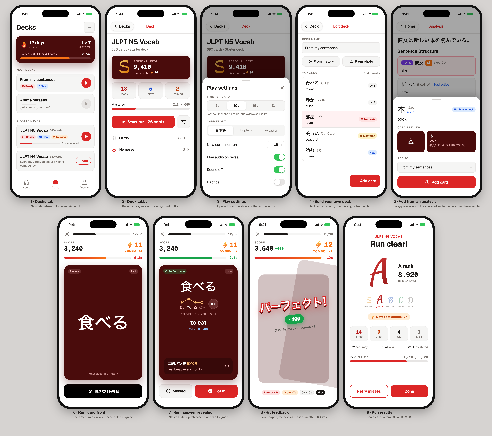

# Flashcard mode plan

Status: planned, not started. Mobile app first; web follows using the same shared code.



`mockups.png` is rendered from `mockups.html`. The HTML loads fonts and icons from public CDNs (Google Fonts, unpkg Ionicons) and is only a design reference. It is not app code.

## Concept

Players study decks of vocabulary cards. Pre-made starter decks are available, and players can build their own. Scheduling works like Anki: a spaced-repetition algorithm decides when each card comes back. Each study session is a timed **Run** with combos, a score and a final rank. The game layer only changes how answers are graded and shown, never when a card is due.

The UI uses game vocabulary instead of Anki's study terms:

| Anki | Kaitai |
| --- | --- |
| Study session | **Run** |
| New cards | **New** |
| Learning / relearning | **Training** |
| Due reviews | **Ready** |
| Mature card | **Mastered**; every card also shows a level, Lv 1–10 |
| Again / Hard / Good / Easy | **Miss / OK / Great / Perfect** |
| Lapse | **KO** |
| Leech | **Nemesis** |
| Suspend | **Bench** |
| Daily limits | **Daily quest**, e.g. "Clear 40 cards" |
| Streak | **Day streak** |

## Gameplay

### The Run

Opening a deck starts a Run made of the cards that are due plus a few new ones (10 by default). The scheduler is FSRS, the algorithm modern Anki uses.

### Each card

1. The front appears and a timer starts: 5s, 10s or 15s, or **Zen**, which has no timer and no score.
2. The player taps **Reveal**. The back shows the reading with a pitch-accent graph, the meaning and part of speech, an example sentence, and audio.
3. The player taps **Got it** or **Missed**.

### Grades

The player only says whether they knew the card. Reveal time, as a share of the time limit, sets the grade. Each grade has a fixed bonus.

| Grade | Reveal time (10s timer) | Grade bonus | FSRS rating |
| --- | --- | --- | --- |
| **Perfect** (pop text: パーフェクト!) | under 30% (3s) | ×2.0 | Easy |
| **Great** | under 70% (7s) | ×1.5 | Good |
| **OK** | up to 100% (10s) | ×1.0 | Hard |
| **Miss** | Missed, or the timer ran out | 0 points | Again |

The 30% and 70% cut-offs scale with the timer setting. Zen still uses Got it/Missed for scheduling, but because there is no timer, every Got it counts as Good.

### Combo

Each correct answer adds 1 to the combo, and a Miss resets it to 0. The combo sets a multiplier:

| Combo | Multiplier |
| --- | --- |
| 0–4 | ×1 |
| 5–9 | ×1.5 |
| 10–24 | ×2 |
| 25+ | ×3 |

### Score

```
points = 100 × grade bonus × combo multiplier
```

Example: a Perfect on a 10-combo earns 100 × 2.0 × 2 = **+400**.

New cards always use a ×1.0 grade bonus, however fast they are revealed, so players aren't pushed to rush words they haven't learned. They still count toward the combo.

### Rank

At the end, the Run's score is compared with the most points that Run could have earned: every card Perfect, with the combo building from 0, and new cards at ×1.0. That percentage sets the rank.

| Rank | Share of max points |
| --- | --- |
| S | 90%+ |
| A | 75%+ |
| B | 55%+ |
| C | 35%+ |
| D | below 35% |

Using a percentage judges short and long Runs the same way. The mockup's point cut-offs (9,000 / 7,500 / …) are only for illustration.

The results screen shows the rank, the score against the player's best, best combo, how many answers got each grade, accuracy, average reveal time, newly mastered cards and XP gained. Actions: **Retry misses** and **Done**.

### Progress between Runs

- **XP and level:** every Run gives XP. The exact amounts are still to be decided, roughly per correct card plus a rank bonus.
- **Day streak:** playing at least one Run a day keeps it going.
- **Daily quest:** a daily card target.
- **Card level:** Lv 1–10, based on the card's FSRS stability (how long it is remembered). The top level is **Mastered**.
- **Nemesis:** a card that keeps lapsing (Anki's "leech"). Nemeses are listed from the lobby.

## Screens (mobile)

1. **Decks tab:** a new tab between Home and Account. Streak, level, XP and daily-quest banner; the player's decks; starter decks with **+ Add**.
2. **Deck lobby:** personal best (rank, score, best combo), Ready / New / Training counts, mastery bar, **Start run**, and a settings button. Links to Cards and Nemeses.
3. **Play settings sheet:**
   - time per card: 5s, 10s, 15s or Zen
   - card front: Japanese, English, or Listen (audio only)
   - new cards per Run
   - switches for audio on reveal, sound effects and haptics
4. **Edit deck:** rename, add cards from history or from a photo, card list with level, Nemesis or Mastered badges, and **Add card**.
5. **Add from analysis:** long-press a word on the results screen to open a sheet with a card preview and a deck picker. The analyzed sentence becomes the card's example.
6. **Run, front:** progress, score, combo with its multiplier, the draining timer bar, the card, **Tap to reveal**.
7. **Run, back:** reading with the pitch-accent graph and audio, meaning, part of speech, example sentence with audio, **Missed** / **Got it**.
8. **Hit feedback:** a grade pop (パーフェクト! for Perfect), points, the bonus breakdown, and a haptic. The next card slides in after about 600ms.
9. **Results:** described under Rank above.

## Card animations

During a Run, cards should feel like a real deck in your hand, not a sequence of pages.

- **Deck stack:** the next two cards peek out behind the current one, slightly smaller and lower, so the deck looks like a physical pile that shrinks as the Run goes on.
- **Deal in:** when a Run starts, cards are dealt off the stack one after another. Each new card rises from the stack into place with a small spring.
- **Flip on reveal:** tapping Reveal turns the card over in 3D to show the back.
- **Throw away on answer:** the answered card flies off the screen and tilts as it goes. Got it sends it right; Missed sends it left and drops it. The next card moves up from the stack at the same time.
- **Swipe to answer:** once a card is revealed, the player can also drag it right for Got it or left for Missed. The card follows the finger, tilts, and tints green or grey as it nears the threshold. Releasing short of the threshold springs it back to the center.
- **Feedback:**
  - Miss: a short shake before the card flies away.
  - Timer runs out: the card dims, then is thrown away as a Miss.
  - Grade pop and combo counter: they bounce in, and the combo icon pulses when the multiplier moves up a tier.
- **Run end:** the last card flies away, then the results screen arrives. The rank letter is stamped in with a scale-and-settle, and the score counts up.

Build these with Reanimated and Gesture Handler, which are both already in the mobile app. Each card animation should finish in about 250–400ms so it never slows down a fast player. If the system's Reduce Motion setting is on, use simple fades instead of throws, flips and shakes.

## Visual design

- Uses the app's existing tokens from `common/tailwind.config.js`: white and stone neutrals, red-600 brand, the dark-red `card` token for flashcards and highlight panels, and Geist / Geist Mono.
- **Rank letters:** Kaushan Script, a brush-calligraphy font, tilted about 12°. One colour per rank: S gold, A red, B blue, C green, D grey, each fading to a darker shade at the bottom. No background shapes or effects. The font is OFL-licensed and can be bundled with `@expo-google-fonts/kaushan-script`.
- **Icons:**
  - combo: a custom lightning bolt, yellow to orange
  - day streak: a custom teardrop flame, red to amber with a yellow core
  - the "Perfect pace" badge: a stopwatch
  - All icons are custom drawings, not emoji.
- **Pitch accent:** dots over each sound in the reading, high or low, joined by lines, plus a hollow dot for a following particle. A label underneath names the pattern, e.g. "Nakadaka [2]".
- Only the Perfect pop uses Japanese (パーフェクト!). Grades and ranks everywhere else use English and Latin letters.

## Data model

- **`decks`** (`postgres/migrations/004_decks.sql`): shared deck content only. Name, description, an optional owner (deleting the owner's account deletes the deck), a `cards` jsonb array of `DeckCard` (`common/types.ts`), a generated `card_count`, and a `version` that goes up with each content change. One deck can be added by many accounts, so nothing account-specific is stored here.
- **Starter decks** are not in the database. They will ship with the app as JSON with `starter:<slug>` ids, which the `decks` table rejects. Because starter ids never appear in `decks`, per-account tables can't use a foreign key on the deck id.
- Card ids inside `cards` stay the same when a card is edited. Per-account tables still to come (decks an account has added, FSRS state per card, play settings, personal bests, XP/streaks) use `(deck id, card id)` to point at a card.
